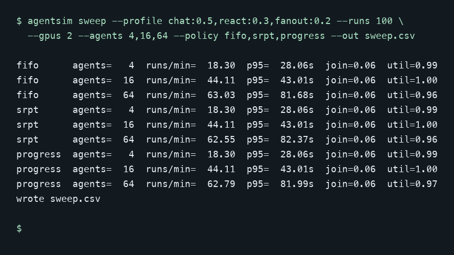

Agent workloads involve repeated model calls, tool use, parallel branches and synchronization delays. These patterns can behave very differently from a single chat request.

[agentsim](https://github.com/AnhDuongVo/agentsim) is a discrete-event simulator that models these workflows across configurable serving replicas. It explores how concurrency, batching, caching and scheduling policies affect latency, throughput and estimated costs.

## Motivation

Serving an agent involves more than serving a single prompt: tool delays, repeated calls and parallel branches can change when requests reach the model and how long users wait. Testing every scheduling or capacity choice on GPUs can be expensive. This project provides a way to explore those choices under explicit assumptions before running hardware experiments.

## What the program does

agentsim takes a workload profile and a serving-cluster configuration, simulates agent runs, and reports throughput, latency percentiles, synchronization delays, utilization and estimated cost per run. Users can compare agent concurrency, replica counts and scheduling policies. An optional benchmark and calibration workflow fits parts of the model to observed endpoint behavior. The results support hypothesis testing and experiment planning; default outputs are simulations.

## Inspect and reproduce



**Example scope:** A modeled workload sweep over a simulated serving cluster. These are modeled latencies and capacity estimates, not hardware measurements.

```bash
pip install -e ".[dev]"
agentsim run --profile fanout --runs 200 --gpus 2 --agents 32
pytest -q
```

The default results use explicit assumptions and synthetic workload profiles. They are modeled results, not measured GPU performance. The repository documents the replica model, scheduling policies, cache assumptions and phenomena it leaves out.

## Calibrate to observed serving behavior

The benchmark requests server-reported prompt and completion token usage. Streaming content chunks are recorded separately because one chunk can contain several tokens. When usage is unavailable, counts are explicitly estimated and excluded from token-latency calibration. Failed requests are recorded rather than disappearing from the result.

```bash
agentsim bench --url http://localhost:8000/v1 --model <model-id> --concurrency 1,4,16 --prompt-tokens 500,2000 --out measurement.jsonl
agentsim calibrate measurement.jsonl --out cluster.json
agentsim run --cluster cluster.json --profile clinical --gpus 1 --agents 16
```

These commands require a running endpoint supporting streaming usage. The effective decode interval is derived from aggregate usage and chunk arrival times; it is not a timestamp for every token. Network latency, server batching and estimated prompt lengths limit the fit. Validate the calibrated model on held-out workloads before using it for capacity planning.
